<div align="center">

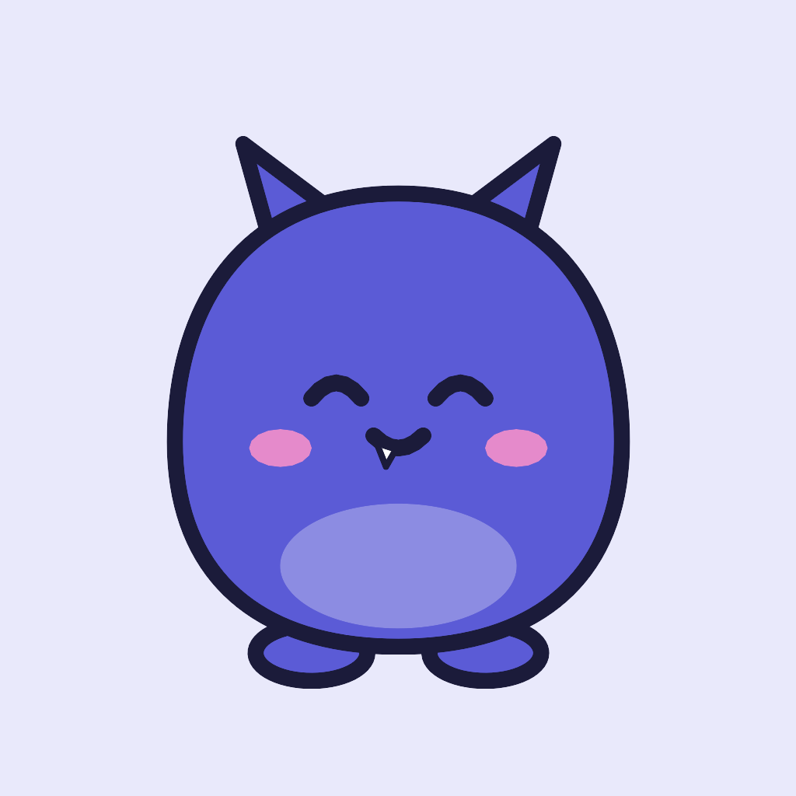

# CalMon

**Track what you eat and how long you work, in one small app.**
<br/>Snap a meal and Gemini counts the calories. Log study and research time against a daily goal.
<br/>Everything stays on your phone.


</div>

---

## What is this?

CalMon has two modes, switched with the **Food / Work** toggle at the top of the main screens:

- **Food** tracks calories. Take a photo of your plate and one Gemini request lists every food with its portion, calories, and macros, and suggests what to eat next. Log your weight and watch both trends in Stats.
- **Work** tracks your time. Log sessions of **Academics**, **Research**, or **Personal Projects** against a daily goal (8 hours by default) and see your hours, streaks, and category split.

Everything stays **on your phone**: meals, work sessions, photos, profile, and API key. No accounts, no servers, no tracking.

When the free Gemini API says *"429: quota exceeded"*, you're still not stuck: **[ask a chat app](#ask-a-chat-app)**. CalMon writes the prompt, you send it to the Gemini or ChatGPT app you already have, and the answer is imported straight back.

Meet **Mon**, the little monster whose face follows your day: sleepy before you start, happy as you go, and dizzy if you overshoot your calories. Mon turns teal in Work mode.

<table>
  <tr>
    <td align="center">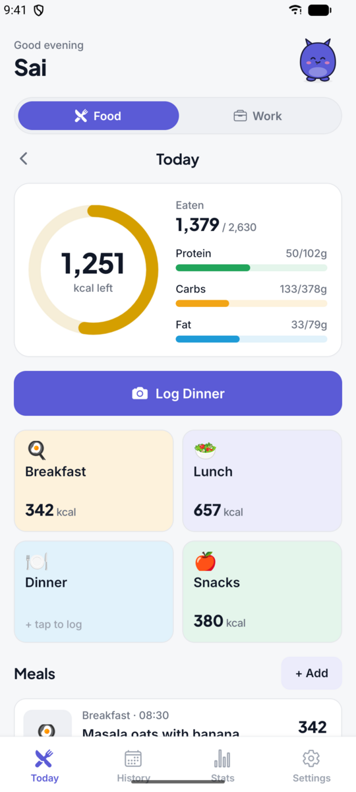<br/><sub><b>Food: today</b></sub></td>
    <td align="center">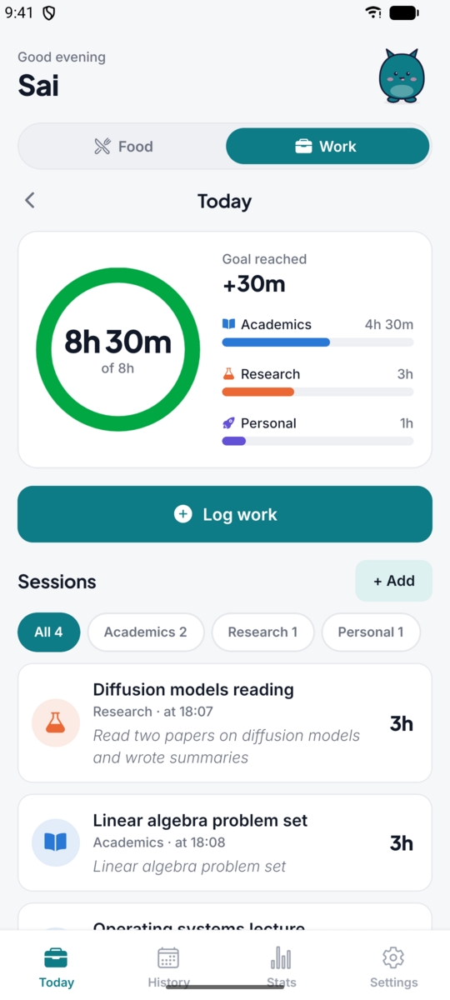<br/><sub><b>Work: today</b></sub></td>
    <td align="center">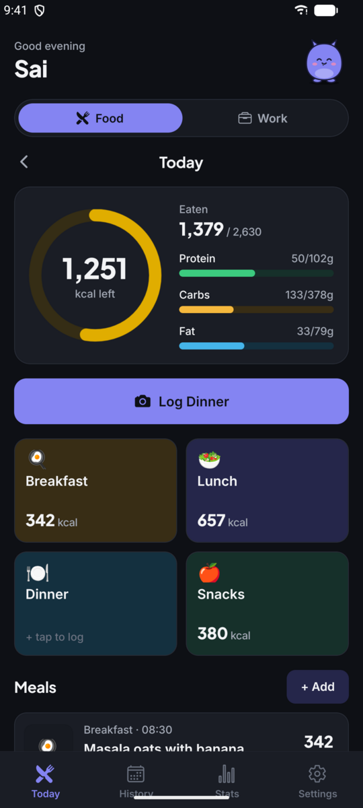<br/><sub><b>Dark mode</b></sub></td>
    <td align="center">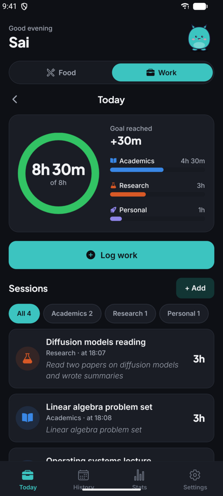<br/><sub><b>Dark mode, Work</b></sub></td>
  </tr>
</table>

---

## Food tracking

### Your day

The ring shows the calories left today and shifts from red to green as you get closer to your target, with bars for protein, carbs, and fat. Each meal fills its own tile. Tap a meal to see the full breakdown, with the meal's description (from Gemini, the chat app, or what you typed) in thin italics under the photo.

<table>
  <tr>
    <td align="center"><br/><sub><b>Today</b></sub></td>
    <td align="center">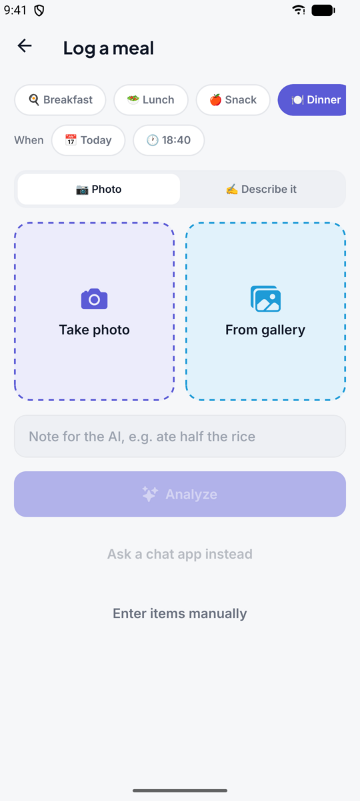<br/><sub><b>Log a meal</b></sub></td>
    <td align="center">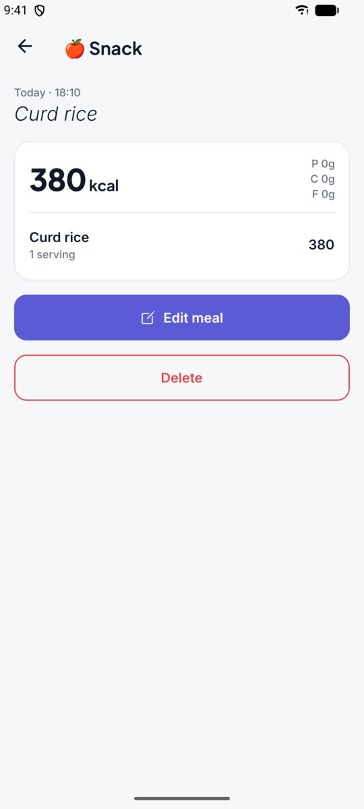<br/><sub><b>Meal details</b></sub></td>
  </tr>
</table>

1. **First launch.** Enter your body stats and CalMon calculates a daily calorie target with the Mifflin-St Jeor formula (or set your own number). Then paste a Gemini API key.
2. **Log a meal.** The meal slot is picked from the clock (breakfast, lunch, snack, dinner, late snack). Take a photo, pick one from your gallery, or describe the meal in words. Add a note like *"ate half the rice"* and tap **Analyze**.
3. **Review and save.** Every item comes back with portion, kcal, and macros. Tap **+ / −** to change quantities and the numbers rescale on-device. Rename items, change units, fix kcal, add or remove items. Below that is a **Next up** suggestion.

### Stats and history

Log your weight for any day; skipped days show as gaps in the line instead of being joined up. The calorie chart stacks breakfast, lunch, dinner, and snacks against your target, or shows one meal at a time, with daily averages per meal underneath. History has a 7-day chart and a month calendar with a dot per day: amber for under, green for on target, red for over.

<table>
  <tr>
    <td align="center">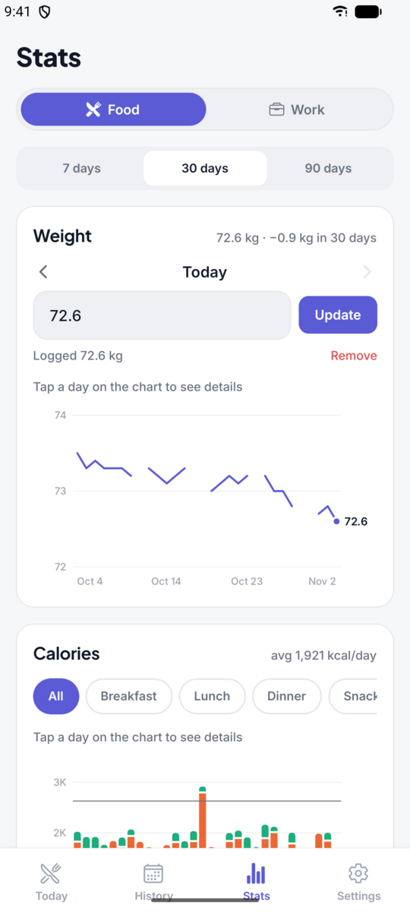<br/><sub><b>Weight</b></sub></td>
    <td align="center">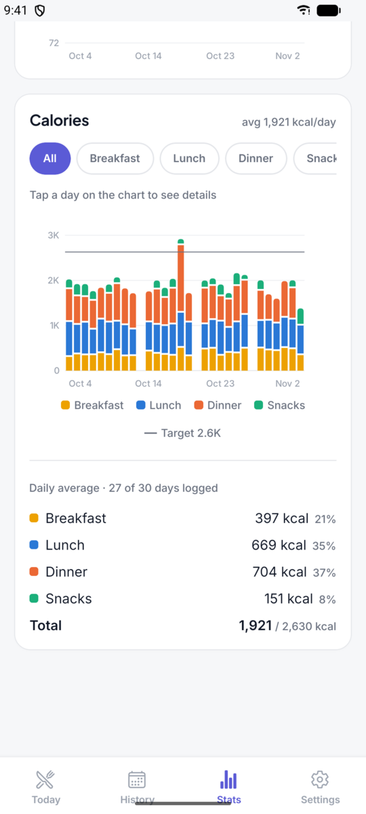<br/><sub><b>Calories by meal</b></sub></td>
    <td align="center">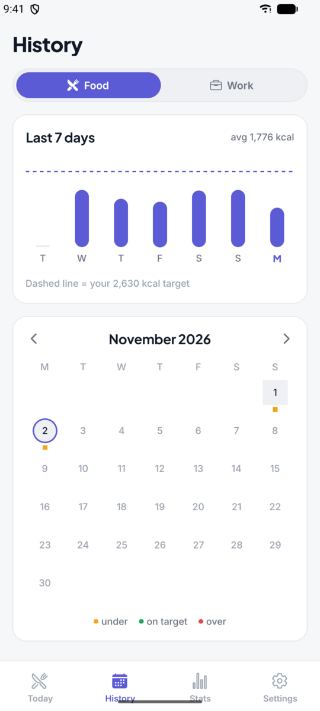<br/><sub><b>History</b></sub></td>
  </tr>
</table>

---

## Work tracking

Flip the **Food / Work** switch and the app turns teal and tracks your work time instead.

### Today and filtering

A ring fills toward your daily goal, with a bar per category. Tap **Academics**, **Research**, or **Personal** in that breakdown (or the chips above the list) to show only that category's sessions; tap again to see everything. While filtered, **Log work** starts in that category.

<table>
  <tr>
    <td align="center"><br/><sub><b>Today</b></sub></td>
    <td align="center">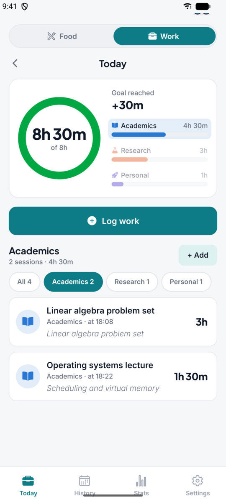<br/><sub><b>Filtered to Academics</b></sub></td>
    <td align="center">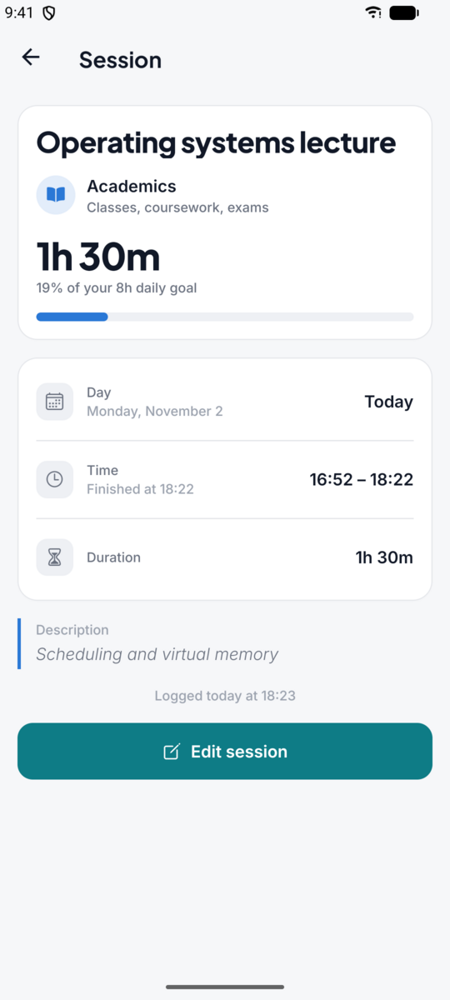<br/><sub><b>Session details</b></sub></td>
  </tr>
</table>

### Logging a session

Give it a title, pick a category, and spin the wheels to set how long: hours go 0 to 12 and minutes 00 to 59, and both wrap around. Quick picks (30m, 1h, 1h 30m, 2h, 3h, 4h) set the wheels for you. Adjust the date and time if you're logging an earlier session, and add an optional description.

| Category | Icon | For |
|---|---|---|
| Academics | 📖 book | Classes, coursework, exams |
| Research | 🧪 flask | Papers, experiments, analysis |
| Personal Projects | 🚀 rocket | Side projects and self-learning |

Tap a session to see everything about it (title, category, duration, the time span you worked, and the description), then **Edit session** to change it or delete it.

### History and stats

History shows the last 7 days against your goal and a calendar where days that hit the goal get a green dot. Stats has tiles for total time, daily average, goal days, and current streak, a chart of hours per day stacked by category with the goal line, and each category's daily average and share.

<table>
  <tr>
    <td align="center">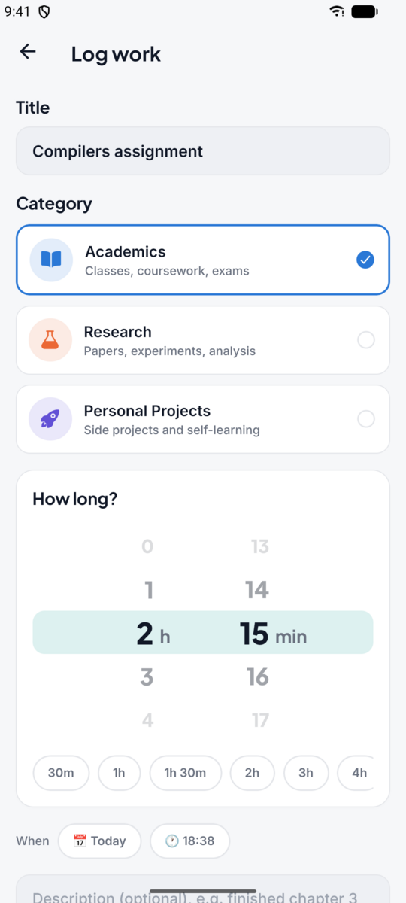<br/><sub><b>Log work</b></sub></td>
    <td align="center">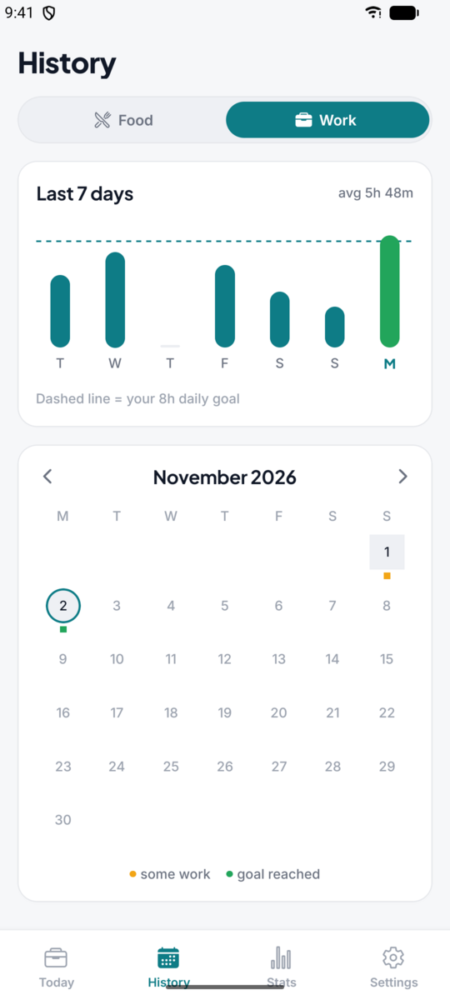<br/><sub><b>History</b></sub></td>
    <td align="center">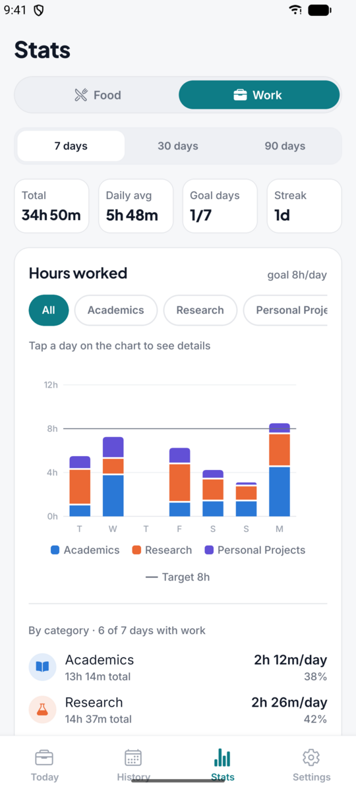<br/><sub><b>Stats</b></sub></td>
    <td align="center">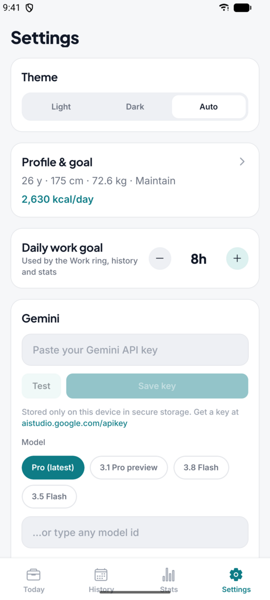<br/><sub><b>Settings</b></sub></td>
  </tr>
</table>

---

## Features

| Feature | Details |
|---|---|
| Photo logging | Take a photo or pick from the gallery. Gemini identifies each food with portion, kcal, protein, carbs, and fat |
| Describe it | No photo? Type *"a cup of masala chai and 4 Parle-G biscuits"* |
| Manual entry | Add items yourself, no AI needed |
| Notes for Gemini | e.g. *"ate half the rice"* or *"no oil"*, for better estimates |
| Smart meal slot | Picked from the time of day. Falls back to *snack* if that meal is already logged |
| Editable review | Quantity steppers rescale kcal and macros locally. Edit names, units, and kcal; add or remove items |
| Next up suggestion | Next meal, time, kcal budget, 2–3 ideas, and a tip, all from the same request. A refresh button appears if you change the meal by more than 15% |
| Log any day | Add earlier meals, log other days, and edit or delete past meals |
| Day view | Calorie ring, macro bars, and a meal grid with photos |
| Stats | Daily weight log, weight trend with gaps for skipped days, calorie chart by meal (all stacked or one meal), daily averages per meal |
| History | 7-day chart and a month calendar with under / on target / over dots. Tap a day to jump to it |
| Personal targets | BMR/TDEE with Mifflin-St Jeor plus activity level and goal (lose / maintain / gain), or your own number |
| Gemini model picker | With automatic fallback, see [Gemini models](#gemini-models) |
| Ask a chat app | Gemini API rate-limited? Share the prompt and photo to the Gemini / ChatGPT app and paste the reply back |
| Work tracking | Food / Work switch, daily hours goal, titled sessions by category (Academics, Research, Personal Projects), scroll-wheel duration picker, filter by category, session details, history and stats |
| Photo cleanup | Photos of meals older than a week are deleted once a day to save space; the meals and their data stay |
| Themes | Light, Dark, or Auto (follows the system); teal accent in Work mode. Plus Jakarta Sans headings with Inter body text |
| Backup | JSON export and import of meals, weights, work sessions, and profile (photos not included) |
| Private by design | SQLite on-device, API key in the secure store (`expo-secure-store`), never in the source |

---

## Setup and run

### What you need

- **Node.js 20+** and npm
- **A phone with [Expo Go](https://expo.dev/go)**, *or* an Android emulator / iOS simulator
- **A Gemini API key**, free at **[aistudio.google.com/apikey](https://aistudio.google.com/apikey)**

### 1. Install

```bash
git clone <repo-url> CalMon
cd CalMon
npm install
```

### 2. Start the dev server

```bash
npx expo start
```

Then:

- **Phone:** scan the QR code with Expo Go (Android) or the Camera app (iOS). Your phone and computer need to be on the same Wi-Fi.
- **Android emulator:** press `a`
- **iOS simulator (macOS):** press `i`

> If the phone can't reach your computer (campus or office Wi-Fi), try `npx expo start --tunnel`.

### 3. First launch

1. Fill in **About you** (age, height, weight, activity, goal). Your daily target is calculated for you.
2. Paste your **Gemini API key** and tap **Test** to check it works.
3. Log your first meal.

Your key is stored only on the device (secure store). It's never committed or sent anywhere except Google's Gemini API.

### 4. (Optional) Build a real app

CalMon uses Continuous Native Generation, so the `android/` and `ios/` folders are generated and you never edit them by hand.

```bash
# One command: checks tools, disk and network, then builds the APK (needs the Android SDK + JDK 17+)
./scripts/build-android.sh release            # standalone APK at android/app/build/outputs/apk/release/
./scripts/build-android.sh debug --install    # dev build, installed on a connected phone or emulator

# Or with Expo directly
npx expo run:android --variant release

# Or build in the cloud with EAS (no local Android Studio / Xcode needed)
npx eas-cli@latest build:configure     # first time only, creates eas.json
npx eas-cli@latest build --platform android
```

---

## Gemini models

The default is **`gemini-pro-latest`**. If Pro has no quota (free-tier keys get 0 Pro requests) or is overloaded, CalMon falls back automatically:

```
gemini-pro-latest → gemini-3.1-pro-preview → gemini-3.8-flash → gemini-3.5-flash → gemini-flash-latest
```

It remembers models that failed for a while, so later calls go straight to one that works. In **Settings** you can pick a model, type any model id, or turn the fallback off.

---

## Ask a chat app

The free Gemini API runs out fast. Your **Gemini app** (or ChatGPT) doesn't. If an analysis fails, the error card offers **Ask Gemini / ChatGPT app**.

1. **Tap "Ask a chat app instead"**, or pick it from the error card.
2. **Tap "Copy prompt & share photo".** CalMon copies a prompt with your whole day in it (what you've eaten, your targets, the time, and the exact JSON format it needs) and opens the share sheet with your photo.
3. **Pick Gemini, paste, send.**
4. **Tap "Copy code" on the reply and come back.** CalMon spots the answer on your clipboard and fills it in.
5. **Tap "Import meal".** You land on the normal review screen with every item and the **Next up** suggestion.

The import tolerates messy replies: code fences, chatty text around the JSON, smart quotes, and trailing commas all parse fine. The prompt starts with a `CALMON v1` marker, so the app never mistakes its own prompt on the clipboard for a reply.

---

## Code map

| Path | What's inside |
| --- | --- |
| `src/app/` | Screens (Expo Router): `(tabs)/index` Today, `(tabs)/history`, `(tabs)/stats`, `(tabs)/settings`, `capture`, `review`, `meal/[id]`, `onboarding`, `profile`, `handoff` |
| `src/components/` | `Mascot` (Mon), `CalorieRing`, `MealGrid`, `MacroBars`, `FoodItemRow`, `RecommendationCard`, `AnalyzingLoader`, … |
| `src/lib/prompt.ts` | Shared prompt, JSON schema, response parsing |
| `src/lib/gemini.ts` | Gemini API transport + model fallback chain |
| `src/lib/handoff.ts` | Chat-app prompt + tolerant paste-back parser |
| `scripts/build-android.sh` | One-command Android build (checks tools, disk and network, then builds the APK) |
| `src/lib/db.ts` | SQLite schema + queries (profile, settings, meals, food_items, weights) |
| `src/lib/work.ts`, `src/components/work/`, `src/app/work/` | Work categories, duration formatting, per-day totals and streaks; Work Today, Stats, the session details screen (`[id].tsx`) and the log / edit screen (`log.tsx`) |
| `src/components/WheelPicker.tsx`, `ModeSwitch.tsx` | Looping hour / minute scroll wheels; the Food / Work toggle |
| `src/lib/stats.ts`, `src/components/charts/` | Stats calculations (day ranges, per-meal totals, weight gaps, axis ticks) and the SVG weight / calorie charts |
| `src/lib/mealSlot.ts`, `nutrition.ts` | Time → meal slot, BMR/TDEE/targets, per-unit scaling |
| `src/lib/backup.ts` | JSON export / import |
| `src/theme/` | Light / dark tokens + `ThemeProvider` |
| `src/store/` | Zustand app store |

---

## Checks

```bash
npm test            # unit tests: slot logic, nutrition math, response parsing, chat-app handoff, stats
npx tsc --noEmit    # typecheck
npx expo-doctor     # dependency / config health check
```

---

<sub>Calorie values are AI estimates. Please don't use them for medical decisions.</sub>
